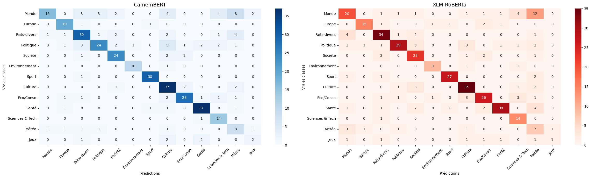

# Classification d'articles de presse français — Version 1 (originale)

> **Ceci est la première version du projet**, conservée telle qu'elle a été rendue dans le cadre du
> Master Exécutif IA & Data Science (Université Paris Dauphine-PSL).
> La version révisée et améliorée se trouve dans le dépôt [`french-news-classification`](https://github.com/ChloeXP/french-news-classification).

## Objectif

Comparer deux modèles Transformer pré-entraînés — **CamemBERT** (`camembert-base`, ~110M paramètres, monolingue français)
et **XLM-RoBERTa** (`xlm-roberta-base`, ~270M paramètres, multilingue) — sur une tâche de classification
d'articles du *Monde* en **13 catégories thématiques** :

Monde · Europe · Faits-divers · Politique · Société · Environnement · Sport · Culture · Éco/Conso · Santé · Sciences & Tech · Météo · Jeux

## Démarche

1. **Données** — dataset Hugging Face [`gustavecortal/diverse_french_news`](https://huggingface.co/datasets/gustavecortal/diverse_french_news),
   filtré sur `lemonde.fr` → 17 980 / 538 / 550 articles (train / val / test).
2. **Étiquetage** — le dataset n'a pas de labels thématiques : chaque article est étiqueté automatiquement
   par un système de mots-clés (titre pondéré ×3, description ×1).
3. **Échantillonnage équilibré** par classe (5 000 / 1 000 / 1 000 max).
4. **Modèle** — encodeur pré-entraîné + embedding `[CLS]` → dropout (0.3) → couche linéaire.
   Entrée : `titre [SEP] description`, `max_length = 256`.
5. **Entraînement** — AdamW, lr = 3e-5, batch = 16 ; Partie I : 3 époques, Partie II : 5 époques.
6. **Évaluation** — accuracy, F1 macro, rapport par classe, matrices de confusion, analyse des erreurs.

## Résultats (test set, 373 articles)

| Expérience | Modèle | Accuracy | F1 macro |
|---|---|---|---|
| Partie I (3 époques) | CamemBERT | 73.46 % | 0.6895 |
| Partie I (3 époques) | XLM-RoBERTa | 69.71 % | 0.6479 |
| Partie II (5 époques) | **CamemBERT** | **74.80 %** | **0.7192** |
| Partie II (5 époques) | XLM-RoBERTa | 72.39 % | 0.6858 |

CamemBERT surpasse XLM-RoBERTa malgré 2,5× moins de paramètres. Les classes les mieux reconnues sont
Sport (F1 0.95) et Environnement (0.91) ; les plus difficiles sont Météo (0.41) et Jeux (0.33), qui sont aussi les moins représentées.

<p align="center">
  
</p>

Autres figures dans [`figures/`](figures/) : distribution des catégories, courbes d'apprentissage, F1 par classe.

## Limites connues de cette version

Ces points ont été identifiés après coup et sont traités dans la [version révisée](https://github.com/ChloeXP/french-news-classification) :

- **Labels générés par mots-clés** : les modèles apprennent en partie à imiter l'heuristique d'étiquetage, pas
  forcément le vrai thème de l'article. Un article sans aucun mot-clé tombe par défaut dans « Monde ».
- **Partie II n'utilise pas tout le jeu d'entraînement** : `N_TRAIN` est fixé à la taille complète (17 980), mais les
  DataLoaders sont toujours construits à partir de `df_train_sample` (échantillon équilibré). Le gain de la Partie II
  vient donc surtout des époques supplémentaires.
- **Test set petit** (373 articles, 7 pour « Jeux ») → les écarts entre modèles sont dans la marge d'incertitude ; une seule graine aléatoire.
- Pas de scheduler de learning rate, de class weights ni d'early stopping.

## Structure

```
.
├── notebooks/
│   └── project-LLM.ipynb   # rapport complet avec code et sorties
├── figures/                # graphiques extraits du notebook
├── requirements.txt
└── README.md
```

## Exécution

Le notebook a été exécuté sur GPU (T4, Kaggle / Colab, Python 3.12).

```bash
pip install -r requirements.txt
jupyter notebook notebooks/project-LLM.ipynb
```

Le dataset est lu directement depuis Hugging Face (`hf://datasets/...`), aucun téléchargement manuel n'est nécessaire.
